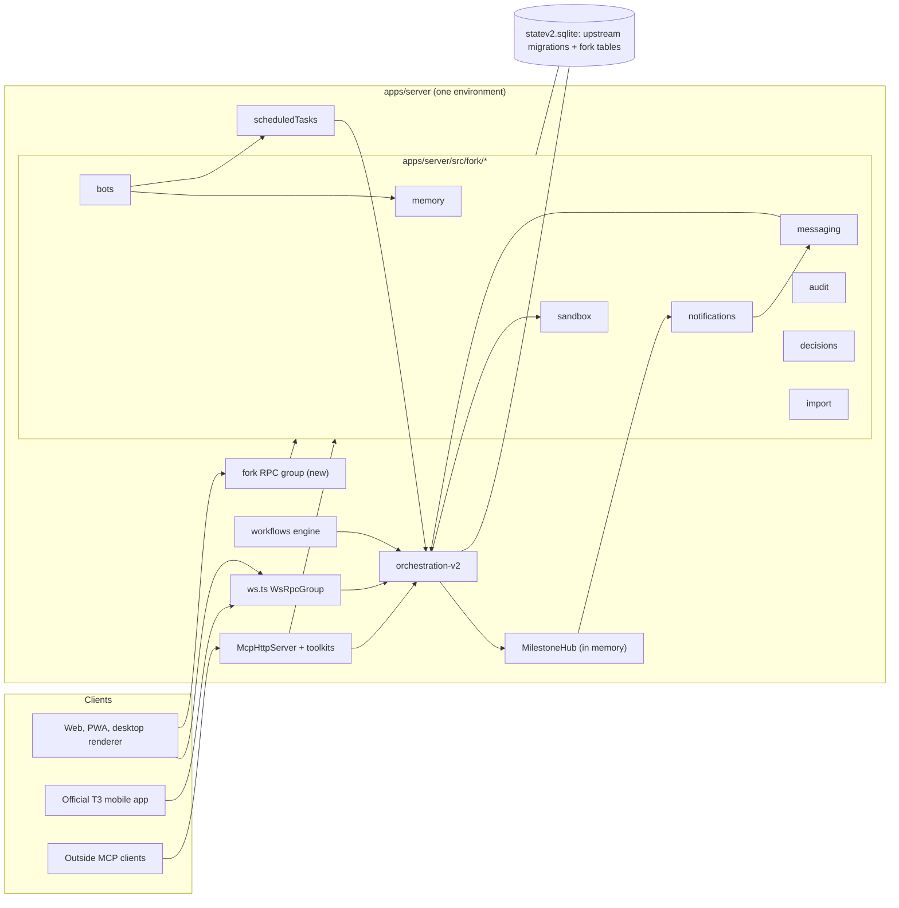
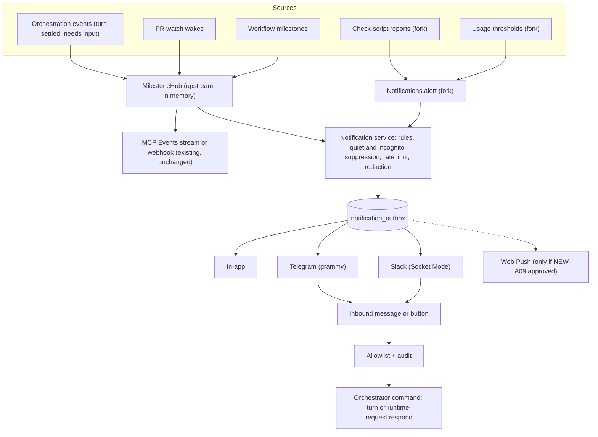
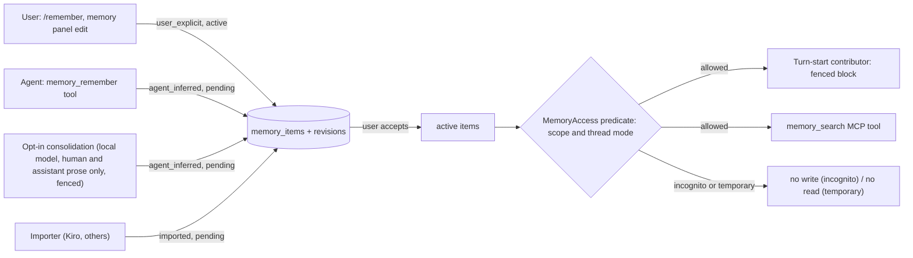

# CMDeck architecture proposal

Brief §12.6. Audit date 2026-11-26. CMDeck pinned at `4a2f27d590` (v3, 3.0.0), upstream T3 Code at
`9b4943f91c` (stable `v0.1.13` = `bc0f04da94`). Feature IDs follow
[RESEARCH_LEDGER.md](RESEARCH_LEDGER.md). Work items (`WI-*`) are defined in
[IMPLEMENTATION_ROADMAP.md](IMPLEMENTATION_ROADMAP.md). The canonical inventory is
[FEATURE_MATRIX.csv](FEATURE_MATRIX.csv), with findings in [FEATURE_AUDIT.md](FEATURE_AUDIT.md),
[KIRO_CREW_PORT_ANALYSIS.md](KIRO_CREW_PORT_ANALYSIS.md) and
[COMPETITIVE_RESEARCH.md](COMPETITIVE_RESEARCH.md). Proposals outside the selected scope are in
[NEW_FEATURE_PROPOSALS.md](NEW_FEATURE_PROPOSALS.md) and are referenced here only as "pending approval".

Paths are repo-relative and were checked to exist at `4a2f27d590`. Paths marked **(new)** do not exist
yet; they are proposed locations. Claims not read in source are marked **(inferred)**.

## 1. The short version

CMDeck already has most of the machinery the wishlist asks for. Of the 73 selected Kiro Crew IDs, the
coverage audit rates 21 Implemented+tested, 1 Implemented, 22 Partial, 8 Harness-provided and 21 Absent
([research/cmdeck-wishlist-coverage.md](research/cmdeck-wishlist-coverage.md)); the matrix re-labels four of the
21 (AGT-05, AGT-06, AUT-02, INF-01) `Experimental` because they are Labs-gated. The architecture
therefore extends five existing primitives and adds a few small fork modules beside them:

1. **Threads stay the unit of work.** Bots, Task Runner runs, conductors, research campaigns and incident
   investigations are ordinary threads (plus a row in a fork table where they need extra state). The
   official mobile app sees them as threads.
2. **One durable engine.** The Effect workflow engine in `apps/server/src/workflows/` hosts every
   multi-step "app" (Task Runner, Spec Builder, Research Lab, Code Review Sage, Auto-Improvement, Ops
   Mission Control) as an installable **preset** workflow file. No second runtime.
3. **One scheduler, one event source.** `apps/server/src/scheduledTasks/` gains cron syntax, a
   deterministic check-script gate, monitor loops and event triggers. `MilestoneHub`
   (`apps/server/src/milestones/MilestoneHub.ts`) stays the single in-memory event source. A new fork
   notification service subscribes to it and owns delivery.
4. **One memory store.** A fork SQLite module (items, revisions, FTS5, optional embeddings) with one scope
   predicate, exposed through MCP tools and a provider-neutral turn-start context seam.
5. **Rules before models.** A small decision service answers routing, context, wake and risk questions
   with deterministic rules first and an optional local model second. It never gates anything a policy
   must enforce.

Everything CMDeck-specific lives in `apps/server/src/fork/<module>/`, `packages/contracts/src/fork/`
(new) and `apps/web/src/fork/` (new), attached to upstream files through single-line hooks the fork guard
checks (§13). Protocol version 2 is never touched.

## 2. Where this proposal departs from the lead decisions

The lead decisions D1–D16 in [RESEARCH_LEDGER.md](RESEARCH_LEDGER.md) are the baseline. These are the
places the evidence pushed a refinement:

| Decision                                                                       | Refinement                                                                                                                                                                                                                                                                                                                                                                                                                                                                                                                                                              | Evidence                                                                                                                                                                                                 |
| ------------------------------------------------------------------------------ | ----------------------------------------------------------------------------------------------------------------------------------------------------------------------------------------------------------------------------------------------------------------------------------------------------------------------------------------------------------------------------------------------------------------------------------------------------------------------------------------------------------------------------------------------------------------------- | -------------------------------------------------------------------------------------------------------------------------------------------------------------------------------------------------------- |
| **D5** "MilestoneHub gains persistence"                                        | **Do not modify MilestoneHub.** The contract states milestones "are derived from the authoritative stores and kept only in memory" (`packages/contracts/src/milestones.ts`, header comment). The new notification service keeps its **own delivery outbox** in a fork table and reconciles pending approvals from projections on start-up **(inferred: projections hold pending runtime requests)**. Fork-only alerts (usage thresholds, check-script reports) call the notification service directly instead of adding members to the upstream `MilestoneEvent` union. | Keeps an upstream file and an MCP Events contract unchanged; delivery state is the only thing that needs durability.                                                                                     |
| **D8** "Self-hosted Web Push (VAPID)"                                          | Web Push is proposal **NEW-A09** in [NEW_FEATURE_PROPOSALS.md](NEW_FEATURE_PROPOSALS.md) and stays **pending approval**. The notification service is channel-neutral; its first channels are in-app and the selected messaging adapters (MSG-01/02). Web Push plugs in as one more channel if approved.                                                                                                                                                                                                                                                                 | Brief rule: do not schedule NEW-* items.                                                                                                                                                                 |
| **D6** "Knowledge Library and Notes are document-type items in the same store" | **Memory items** (short facts, rules, lessons, state cards) live in SQLite, because they need provenance outside the content, revisions, scopes and pending proposals. **Knowledge sources and Notes** stay **files on disk** (a notes folder is a knowledge source) with a SQLite chunk index next to the memory tables. Users edit notes with the existing file editor.                                                                                                                                                                                               | Kiro's notes app is a markdown folder (`research/kirocrew-tools-infra-apps.md` PRD-03); competitive research recommends files as source of truth for documents (`research/competitive-libraries.md` §2). |
| **D4** "Workflows graduate from Labs"                                          | Graduation also needs a **workflow file trust gate**. Workflow files are TypeScript the server imports in-process (`apps/server/src/workflows/WorkflowRuntime.ts:151`, `import(url)`), hot-reloaded from the workflows folder, with no hash or approval check (searched `WorkflowRuntime.ts` for approve/trust/hash/digest: none). An agent that can write that folder can run code with server privileges. New or changed files load only after the user approves their hash.                                                                                          | Brief §10: agents must not bypass policy through prompts. Kiro's equivalent runs model-written Python in its gateway and is flagged as a design not to copy.                                             |
| **D4 / AGT-06** selective retry                                                | **Covered.** A failed step pauses the run and resume re-executes only that step (`apps/server/src/workflows/workflow.ts` `StepRetry`, `Workflows.test.ts:1061`). "Retry from an arbitrary earlier step" needs an engine change inside upstream code and is **deferred** (propose upstream).                                                                                                                                                                                                                                                                             | Kiro itself only has rerun-from-index ([research/kirocrew-agents-memory-automation-chat.md](research/kirocrew-agents-memory-automation-chat.md) AGT-06).                                                 |
| **D3** "tables in `ForkSchema.ts`"                                             | Keep `ensureForkSchema` as the single entry, but each fork module owns a `schema.ts` with its own idempotent `ensure*Schema()`; `ForkSchema.ts` calls them one line each.                                                                                                                                                                                                                                                                                                                                                                                               | Lets parallel work items add tables without editing the same function body.                                                                                                                              |
| **D13** Teams                                                                  | Teams stays conditional (public HTTPS endpoint plus Azure Bot registration). Scheduled in the last phase behind an approval.                                                                                                                                                                                                                                                                                                                                                                                                                                            | `research/kirocrew-tools-infra-apps.md` MSG-03.                                                                                                                                                          |
| **D9** SageMaker                                                               | The decision service defines a provider interface, but the SageMaker provider (AWS-05) is **deferred**. Local and rules-only providers ship first.                                                                                                                                                                                                                                                                                                                                                                                                                      | `AWS_BEDROCK.md` §4(c).                                                                                                                                                                                  |

## 3. Subsystem plan

| Action                            | Subsystem                                                              | Where                                                                                                  | Notes                                                                                                                      |
| --------------------------------- | ---------------------------------------------------------------------- | ------------------------------------------------------------------------------------------------------ | -------------------------------------------------------------------------------------------------------------------------- |
| **Retain**                        | Event-sourced orchestration, threads, linked threads, fork/side chats  | `apps/server/src/orchestration-v2/`                                                                    | Unchanged. All new "apps" render as threads.                                                                               |
| Retain                            | Provider adapters, ACP, ACP Registry                                   | `apps/server/src/orchestration-v2/Adapters/`, `packages/provider-*`                                    | goose stays a generic ACP agent (CMD-11).                                                                                  |
| Retain                            | Worktrees, multi-repo, Git, PR/issue links, PR watch, CI logs          | `apps/server/src/vcs/`, `workspace/`, `pullRequest/`                                                   | CMD-15/17, AUT-05 covered.                                                                                                 |
| Retain                            | Git checkpoints                                                        | `apps/server/src/checkpointing/`, `orchestration-v2/Checkpoint*.ts`                                    | Workspace only (§14).                                                                                                      |
| Retain                            | Remote environments, peer links, SSH, Tailscale, E2EE                  | `apps/server/src/peer/`, `packages/ssh`, `packages/tailscale`, `packages/shared/src/socketE2ee.ts`     | The remote execution abstraction already exists (§11).                                                                     |
| Retain                            | Server browser with human takeover                                     | `apps/server/src/preview/ServerBrowser.ts`, `SessionControl.ts`                                        | TLS-01 covered. Shared by DEV-04/05.                                                                                       |
| Retain                            | Usage tracking, limit recovery                                         | `apps/server/src/usage/`, `orchestration-v2/UsageLimitRecoveryWorker.ts`                               | Budgets wait for upstream (D15).                                                                                           |
| Retain                            | Local inference gateway (M3 port)                                      | `apps/server/src/inference/`                                                                           | Reused by memory consolidation, embeddings and the decision service.                                                       |
| **Extend**                        | Scheduled tasks                                                        | `apps/server/src/scheduledTasks/`, `packages/contracts/src/scheduledTask.ts`                           | Cron + timezone, failure auto-pause, quota hold, check-script gate, monitor loops, event triggers (WI-1.05, WI-2.11–2.13). |
| Extend                            | Workflows                                                              | `apps/server/src/workflows/`                                                                           | Trust gate, preset install, default-on decision (WI-1.06); presets (WI-2.01, 2.03, 2.20, 3.06, 3.07).                      |
| Extend                            | Managed policy and approvals                                           | `apps/server/src/policy/`, `orchestration-v2/ProviderEventIngestor.ts` (candidate seam)                | Server-side deny rules on provider approval requests (WI-2.16).                                                            |
| Extend                            | Secrets                                                                | `apps/server/src/auth/ServerSecretStore.ts`, `secrets/`                                                | Encryption at rest with an OS-keychain-held key (WI-2.17).                                                                 |
| Extend                            | Redaction                                                              | `apps/server/src/serverLogger.ts` (`Redactable`), `settingsSecrets.ts`, `feedback/scrubFeedback.ts`    | One shared redactor applied at log, export and outbound egress (WI-1.02).                                                  |
| Extend                            | Importer                                                               | `apps/server/src/fork/T3Import.ts`, `apps/server/src/cli/importFromT3.ts`, `apps/server/src/binCli.ts` | `cmdeck import <source>` (WI-1.08, WI-3.03).                                                                               |
| **Consolidate**                   | Two schedulers (scheduled tasks and workflow `every`/`daily` triggers) | `scheduledTasks/Schedule.ts`, `workflows/triggers.ts`                                                  | Keep both front ends; share one cron/next-run implementation added in WI-1.05 instead of growing a third.                  |
| Consolidate                       | Turn-start context                                                     | Memory, bot instructions, thread notes and session state cards all add text at turn start              | One fork "turn context contributor" seam created by WI-1.07; other WIs register into it.                                   |
| Consolidate                       | Approval-request interception                                          | Policy deny rules (INF-05) and risk annotation (TLS-08)                                                | One seam created by WI-2.16; the decision service registers an annotator.                                                  |
| **New (fork module)**             | Memory store                                                           | `apps/server/src/fork/memory/` (new)                                                                   | §4.1                                                                                                                       |
| New                               | Notification delivery                                                  | `apps/server/src/fork/notifications/` (new)                                                            | §4.2                                                                                                                       |
| New                               | Decision service                                                       | `apps/server/src/fork/decisions/` (new)                                                                | §4.3                                                                                                                       |
| New                               | Messaging adapters                                                     | `apps/server/src/fork/messaging/` (new)                                                                | §4.4                                                                                                                       |
| New                               | Audit log                                                              | `apps/server/src/fork/audit/` (new)                                                                    | §4.5                                                                                                                       |
| New                               | Sandbox runner                                                         | `apps/server/src/fork/sandbox/` (new)                                                                  | §4.6                                                                                                                       |
| New (generalization)              | Importer framework                                                     | `apps/server/src/fork/import/` (new), absorbing `fork/T3Import.ts`                                     | §4.7                                                                                                                       |
| New (thin tables, not subsystems) | Bot profiles, work ledger, thread notes and pins                       | `apps/server/src/fork/{bots,workLedger,threadAnnotations}/` (new)                                      | Each is a table plus a service, MCP tools and a panel. No runtime.                                                         |

Verified against the notes: no other new subsystem is needed. Session search, forking, cross-session
control, queued-message editing, inbound webhooks, PR monitoring, headless gateway, crash recovery and
alternative harnesses already exist (FEATURE_MATRIX rows; roadmap "Not scheduled" table).

## 4. The new fork modules

Every module follows `docs/internals/02_effect-services.md`: one `Context.Service` per module with
`Effect.fn("Service.operation")` methods, thin RPC/MCP/HTTP handlers, contracts in
`packages/contracts/src/fork/` (new), and capabilities reachable from MCP tools and scheduled tasks, not
only from UI handlers (AGENTS.md "Agents").

### 4.1 Memory store (MEM-01..08, AGT-08, part of AGT-02/MEM-05)

- **Storage (fork tables):** `memory_items` (id, scope, kind, content, provenance, origin thread/run,
  importance, status `active | pending | retired`, valid/invalid timestamps, `embedding` BLOB nullable,
  `embedding_model` nullable), `memory_revisions` (before/after JSON per write), `memory_fts` (FTS5),
  `thread_memory_mode` (thread id → `persistent | incognito | temporary`), `memory_injections`
  (thread, run, item ids used).
- **Scopes:** `global | user | project:<id> | repo:<remote-url> | bot:<id> | thread:<id>`. Repository
  lessons are keyed by project id and remote URL, not by path fragments (Kiro's `src` false-match
  weakness).
- **One predicate** `MemoryAccess.canRead/canWrite(thread)` is called by every reader and writer.
  Incognito: reads allowed, writes refused. Temporary: no reads, no writes. A failed lookup counts as
  restricted. Reverse state: "Promote to persistent".
- **Provenance and trust.** `user_explicit | user_confirmed | agent_inferred | imported`. Only the first
  two can become standing rules. Agent-written items and imports arrive as `pending`. Tool output and
  fetched content never enter the consolidation input.
- **Read path.** Retrieval is FTS5 BM25 first; optional embeddings come from a configured local inference
  server (no downloads) and are brute-force cosine over BLOBs. Decay is a ranking factor only
  (exponential, none for user-taught rules); deletion only by explicit retention.
- **Exposure.** MCP tools (`memory_search`, `memory_remember`, `memory_forget`) for every provider, plus
  the turn-start contributor that adds standing rules and top-k relevant items as a fenced block. The
  block is added to the provider input at turn start (candidate seam
  `apps/server/src/orchestration-v2/ProviderTurnStartService.ts`), **not** stored in the thread message,
  so orchestration events and the official mobile app are unchanged. What was injected is recorded in
  `memory_injections` and shown in the thread's memory panel.
- **Honest limits.** Same-user code can read the SQLite file. A provider's own memory (Claude Code
  project memory, Codex memories) is outside CMDeck's control; the incognito chip says so.
- **What it is not:** no vector DB, no graph DB, no second lineage, no background inference unless the
  user opts in per project.

### 4.2 Notification delivery (AUT-03, AUT-04, INF-10 alerts, CHT-08, MSG-*)

- **Input:** a live subscription to `MilestoneHub` (`thread.run_settled`, `thread.needs_input`,
  `pr.watch_wake`, `workflow.*`) plus `Notifications.alert(...)` for fork-only events.
- **Policy:** per-channel rules (projects, event kinds, quiet hours), suppression of quiet turns and of
  incognito/temporary threads, rate limits per channel, redaction of every outbound payload (WI-1.02).
- **Storage:** `notification_channels` (config, secrets by reference), `notification_outbox` (one row per
  milestone id per channel: at-least-once with dedupe by milestone id).
- **Channels:** in-app (existing toast surfaces), messaging adapters (§4.4), and Web Push only if NEW-A09
  is approved. MCP Events webhooks (`apps/server/src/mcp/McpWebhookTransport.ts`) stay as they are.
- **Inert when disabled:** no channel configured means no subscription fibre is started.

### 4.3 Decision service (TLS-05..08)

- **Shape:** typed questions (`choice`, `yes/no`, `score`) per decision point; each point has a
  deterministic rule that is also the fallback. Providers: `rules` (default), `local` (via
  `apps/server/src/textGeneration/TextGenerators.ts` with a new purpose, preferring local inference as
  M3-01 already does), `thread-provider` (opt-in consent). SageMaker is deferred.
- **Points:** model routing for automation-started threads (TLS-05); narrowing recalled memory items
  (TLS-06); suppress-only wake decisions for monitor loops, which can delay a tick but never end a watch
  or swallow a failure (TLS-07); risk annotations on approval requests from deterministic rules
  (sensitive paths, destructive command shapes), shown in the approval card and never consulted by the
  policy (TLS-08).
- **Not a security boundary**, by construction: the policy seam (WI-2.16) runs before and independently
  of any annotation. No hosted Jev/TypeSafe endpoint, no model downloads.

### 4.4 Messaging adapters (MSG-01..03)

- **One interface** (`MessagingAdapter`: connect, send, edit, receive, approve) in
  `apps/server/src/fork/messaging/` (new). Telegram via `grammy` long polling and Slack via Socket Mode
  need **no inbound port and no intermediary**. Teams needs a public HTTPS endpoint (Cloudflare Tunnel)
  and an Azure Bot registration; it is conditional.
- **Thread mapping:** a chat/thread on the messaging side maps to a CMDeck thread (often a bot's pinned
  thread). Inbound text becomes an ordinary turn through the orchestrator; approvals become
  `runtime-request.respond` commands (`packages/contracts/src/orchestrationV2.ts:3743`) issued by the
  server on behalf of an allow-listed sender.
- **Authorization:** deny by default. An empty allowlist refuses to connect (Kiro only warns). Every
  inbound command and approval is audited (§4.5). Typed-reply approvals bind to one request id and deny
  on silence.
- **Inert when disabled:** the SDK is loaded with a dynamic `import()` only inside the layer that starts
  when a channel is enabled.

### 4.5 Audit log (INF-08)

- Append-only fork table `audit_events` with a SHA-256 hash chain that continues across retention
  pruning (a pruning event records the last pruned hash, closing Kiro's segment-deletion gap). Optional
  signed checkpoints are deferred.
- Sources: approval decisions and policy denies, device pairing approvals, remote MCP token create/use/
  revoke, secret reveals, inbound messaging commands, workflow file approvals, sandbox opt-outs, import
  runs.
- Viewer: a list with a "Verify chain" action in Settings → Diagnostics. Described as
  **tamper-evident, not tamper-proof**: a same-user process can rewrite the file and the chain.

### 4.6 Sandbox runner (CMD-09, INF-09; CMD-10 spike)

- **Seam:** the existing `AgentScope` reference (`packages/shared/src/AgentScope.ts`,
  `AgentScopeThreadId`, `agentScopeCommand`), which already wraps agent processes in systemd scopes on
  Linux (`apps/server/src/process/agentScope.ts`) and is consumed by the Claude and Codex adapters,
  `ProviderSessionManager.ts` and `terminal/Manager.ts`. A Docker implementation wraps the **whole
  provider process** for a sandboxed thread, so the harness's own shell and edit tools are inside the
  boundary (container-use's tool-only routing is not an enforced boundary).
- **Recipe:** Agent of Empires' mount table (MIT, attribute when porting): worktree read-write at the
  same absolute path, `.git/config`, `config.worktree` and `hooks` read-only, no `~/.ssh`/`~/.aws`
  unless the recipe asks, provider credentials as an env-file, `--network none` by default (or a user
  network), CPU/memory caps, label `cmdeck.thread=<id>` for reaping on start-up. Shell out to the
  `docker` CLI; no Docker SDK dependency.
- **Limits stated in the UI and docs:** a container shares the host kernel and is not a VM. Docker
  Desktop on Windows/macOS adds a VM, which is stronger but path mapping differs. gVisor (`runsc`) is an
  optional runtime on Linux hosts. Domain allowlists need a proxy and are deferred.
- **Windows Sandbox (CMD-10):** feasibility spike first. Windows Sandbox is single-instance, starts empty
  every launch, and has no exec API beyond a logon command **(inferred from platform documentation, not
  verified here)**, so a long-lived interactive provider session may not fit.

### 4.7 Importer framework (CMD-19..21, INF-12, INF-03)

- `Importer` per source producing the existing `ImportPlan`/`ImportItem` shape with the
  plan → dry-run → run flow and timestamped backups from `apps/server/src/fork/T3Import.ts`.
- **T3 source:** today's file-copy behaviour, unchanged.
- **Kiro Crew source:** reads Kiro's portability export zip (or a live home read-only, copying SQLite
  files before opening). It maps records through services, like upstream's
  `apps/server/src/orchestration-v2/legacy/LegacyV1ThreadImporter.ts`: preferences and facts become
  memory items (`imported`, pending), lessons become pending proposals, bots become bot profiles, crons
  become **disabled** scheduled tasks, approved skills are copied, MCP server definitions are imported
  disabled. Never imported: secrets, telemetry ids, workflow Python, webhook tokens. Transcripts are an
  open decision (A8).
- **Snapshot source/target (INF-03):** export and import of CMDeck's own state (consistent SQLite backup
  of `statev2.sqlite` including fork tables, plus settings), secrets excluded by default, redacted on
  export.

## 5. External components

| Component                                                 | License                            | Use                                                                                    | Reason                                                                                                           |
| --------------------------------------------------------- | ---------------------------------- | -------------------------------------------------------------------------------------- | ---------------------------------------------------------------------------------------------------------------- |
| `grammy`                                                  | MIT                                | **Adopt** (lazy-loaded) for MSG-02                                                     | TS, long polling, no inbound port ([research/competitive-libraries.md](research/competitive-libraries.md) §3).   |
| `@slack/bolt` or `@slack/socket-mode`                     | MIT                                | **Adopt** (lazy-loaded) for MSG-01                                                     | Socket Mode needs no public endpoint.                                                                            |
| A small cron parser (candidate: `croner`)                 | MIT **(verify at implementation)** | **Adopt** for WI-1.05 if a DST-correct next-run cannot be written in a few dozen lines | One library, shared by both scheduler front ends.                                                                |
| Docker / Podman CLI                                       | user-installed                     | **Use** via `HostProcess`, no SDK                                                      | Optional; absence disables the sandbox option.                                                                   |
| tectonic / pdflatex                                       | user-installed                     | **Use** for PRD-01 compile, no shell-escape                                            | Optional.                                                                                                        |
| AWS MCP Server, awslabs MCP servers, Agent Toolkit skills | Apache-2.0                         | **Document**, never bundle                                                             | Configured in each harness by the user ([AWS_BEDROCK.md](AWS_BEDROCK.md) §4b).                                   |
| `@microsoft/teams.apps`                                   | MIT **(inferred, not checked)**    | Conditional on A7                                                                      | Needs public HTTPS.                                                                                              |
| `web-push`                                                | MPL-2.0 (weak copyleft, per file)  | Web Push channel (WI-3.11)                                                             | Approved 2026-11-26 (A14); use unmodified.                                                                       |
| Kiro Crew                                                 | Apache-2.0 + NOTICE                | **Reference only** (Python)                                                            | Behaviours, not code. Keep NOTICE if any text (prompts, regex lists) is copied.                                  |
| Agent of Empires                                          | MIT                                | **Port pattern** (container mount table) with attribution                              | §4.6.                                                                                                            |
| Podium, Sillage, Frink, Paseo, OpenChamber                | Apache-2.0 / MIT                   | **Reference only**                                                                     | Check-script gate (Sillage), messaging brakes (Podium, NEW-A02 pending).                                         |
| Mem0, Letta, Graphiti, OpenClaw, Hermes                   | various                            | **Reference only**                                                                     | Memory patterns (§4.1).                                                                                          |
| Temporal, Trigger.dev, LangGraph, OpenHands               | various                            | **Reference only**                                                                     | CMDeck's Effect engine already journals and replays.                                                             |
| PR-Agent, Aider                                           | Apache-2.0 / Apache-2.0            | **Reference only**                                                                     | Deterministic risk checks; repo map deferred.                                                                    |
| OPA, OpenShell, gVisor                                    | Apache-2.0                         | **Reference only**; `runsc` optional runtime                                           | Typed TS policy is enough.                                                                                       |
| sqlite-vec                                                | Apache/MIT                         | **Not now**                                                                            | Extensions are disabled (`Sqlite.test.ts`); brute force is enough below ~100k rows.                              |
| M3 plugin host, M3 mTLS listener, `apps/m3-server`        | MIT                                | **Do not introduce**                                                                   | Ineffective iframe sandbox, breaks official clients, orphaned ([M3_CODE_ANALYSIS.md](M3_CODE_ANALYSIS.md) §4–5). |
| Hosted Jev/TypeSafe, Kiro relay, Kiro CDNs, Cloudscape    | —                                  | **Excluded**                                                                           | Phone-home or hosted dependency.                                                                                 |

## 6. Dependencies and data ownership

Dependency rules:

- Fork modules depend on upstream services; upstream code depends on fork code only through the hooks in
  §13.
- `notifications` depends on `audit` and the shared redactor. `messaging` depends on `notifications` and
  `audit`. `bots` depends on `memory` and scheduled tasks. `decisions` depends on nothing fork-side.
  `import` depends on `memory`, `bots` and the scheduler for the Kiro source.
- Web reaches fork features only through the fork RPC group and `apps/web/src/fork/` (new) panel and
  command registries. Mobile is never changed.

### Persistence

| Data                                                      | Owner                                  | Storage                                                    | Notes                                                                                               |
| --------------------------------------------------------- | -------------------------------------- | ---------------------------------------------------------- | --------------------------------------------------------------------------------------------------- |
| Threads, runs, messages, approvals, projections, receipts | orchestration-v2 (upstream)            | `statev2.sqlite`, numbered migrations                      | Bounded event log; never edited by the fork.                                                        |
| Workflow runs, steps, waits                               | workflows (upstream)                   | `statev2.sqlite` (migrations 110–119)                      | The journal (§14).                                                                                  |
| Workflow definitions                                      | user + presets                         | `~/.cmdeck/workflows/*.ts` (`T3CODE_WORKFLOWS`)            | Trust-gated (WI-1.06). Approved hashes in a fork table `workflow_trust`.                            |
| Scheduled tasks                                           | scheduledTasks (upstream)              | `statev2.sqlite`                                           | Cron and check-script fields added in the upstream-shaped contract, upstream PR proposed (WI-1.05). |
| Inference request log, pairing requests                   | fork (existing)                        | `ForkSchema.ts`                                            | Existing.                                                                                           |
| Memory items, revisions, FTS, modes, injections           | `fork/memory`                          | fork tables                                                | §4.1.                                                                                               |
| Knowledge index                                           | `fork/memory` (knowledge submodule)    | fork tables (`knowledge_sources`, `knowledge_chunks`, FTS) | Source of truth stays the files.                                                                    |
| Notes                                                     | user                                   | markdown files in a chosen folder                          | Indexed as a knowledge source.                                                                      |
| Bot profiles                                              | `fork/bots`                            | fork table `bot_profiles`                                  | Thread, scope, schedule ids, channel bindings.                                                      |
| Work ledger                                               | `fork/workLedger`                      | fork table `work_items`                                    | Conductor/worker fields split.                                                                      |
| Thread notes and message pins                             | `fork/threadAnnotations`               | fork tables                                                | Not orchestration events (§12).                                                                     |
| Notification channels, outbox                             | `fork/notifications`                   | fork tables                                                | Channel secrets are secret references.                                                              |
| Audit events                                              | `fork/audit`                           | fork table                                                 | Hash-chained.                                                                                       |
| Secrets                                                   | `auth/ServerSecretStore.ts` (upstream) | files in the secrets dir, encrypted at rest after WI-2.17  | Data key in OS keychain or a documented file fallback.                                              |
| Settings                                                  | settings service (upstream)            | `userdata/settings.json`                                   | Fork settings nested under one `cmdeck` key (WI-1.01).                                              |

## 7. Event pipeline

Scheduling sits upstream of this pipeline: scheduled tasks (interval, fixed time, once, webhook, cron),
check-script gates and monitor loops decide **whether** an agent turn starts. Only a report or a failure
reaches an agent or a person, so routine monitoring needs no inference (brief §9.5).

## 8. Memory trust flow

The regex injection screen on writes is hygiene, not a boundary. The boundary is that nothing an agent
or an import writes becomes a standing rule without a person accepting it, and every write is a
revision that can be reverted.

## 9. Security boundaries

| Control                                                                                          | Enforced by                                                                                                              | Kind                         | Honest limit                                                                                                                        |
| ------------------------------------------------------------------------------------------------ | ------------------------------------------------------------------------------------------------------------------------ | ---------------------------- | ----------------------------------------------------------------------------------------------------------------------------------- |
| RPC method scopes, device approval, pairing                                                      | `auth/RpcAuthorization.ts`, `packages/contracts/src/clientRpcPermissions.ts` `CLIENT_GUARDED_RPC_SCOPES`, `auth/http.ts` | **Code**                     | Fork RPCs must declare scopes in the same table.                                                                                    |
| MCP tool access, no-escalation for children                                                      | `mcp/McpToolAccess.ts`, `mcp/delegatedTaskModes.ts`                                                                      | **Code**                     | —                                                                                                                                   |
| Runtime mode caps, managed policy                                                                | `policy/ManagedPolicy.ts`, `orchestration-v2/RuntimePolicy.ts`                                                           | **Code**                     | Inside a turn, enforcement is the harness's (approvals, Codex sandbox).                                                             |
| Server-side deny rules on approval requests (WI-2.16)                                            | fork policy seam                                                                                                         | **Code**                     | Applies only when the harness asks. A provider in full-access mode does not ask.                                                    |
| Workflow file trust gate (WI-1.06)                                                               | `WorkflowRuntime.ts` hook                                                                                                | **Code**                     | Approved files still run with server privileges; approval is the boundary.                                                          |
| Memory scope and modes                                                                           | `MemoryAccess` predicate                                                                                                 | **Code (application level)** | Same-user processes can read the DB. Provider-owned memory is outside CMDeck.                                                       |
| Container sandbox (WI-2.18)                                                                      | Docker/Podman                                                                                                            | **OS (namespaces, cgroups)** | Not a VM; shared kernel; network `none` by default; allowlists deferred.                                                            |
| Secrets at rest (WI-2.17)                                                                        | OS keychain (desktop), file key (headless)                                                                               | **Crypto**                   | Protects copies of the disk and backups. A same-user process that can ask the keychain, or read the fallback key file, can decrypt. |
| Redaction (WI-1.02)                                                                              | shared redactor at log/export/outbound egress                                                                            | **Code, best effort**        | Rule tables miss unknown formats; never sees bytes a subprocess sends itself.                                                       |
| Audit chain (WI-1.03)                                                                            | fork table                                                                                                               | **Tamper-evident**           | Not tamper-proof without external anchoring.                                                                                        |
| Messaging sender allowlist                                                                       | adapter                                                                                                                  | **Code**                     | Depends on the platform's sender identity (Slack/Telegram user ids).                                                                |
| Risk flags, decision service, memory injection screen, prompt fencing, browser domain allowlists | —                                                                                                                        | **Advisory**                 | Never presented as a security control.                                                                                              |
| AWS spending                                                                                     | IAM, Budgets                                                                                                             | **External**                 | Budgets lag and are not a hard cap ([AWS_BEDROCK.md](AWS_BEDROCK.md) §6).                                                           |

Secrets never go to agents by default: provider credentials are injected per provider instance
(`packages/contracts/src/providerInstance.ts` secret references), and the ambient `AWS_*` leak into every
agent (`packages/provider-core/src/server/instanceEnvironment.ts` `mergeProviderInstanceEnvironment`
copies `process.env`) is fixed by WI-3.10 if approved (A4).

## 10. Optional-module isolation

Rules for AWS, messaging, productivity, Web Push (if approved), engine management (if approved) and the
sandbox:

1. **Disabled by default.** A module's settings live under the `cmdeck` settings key; absence means
   disabled.
2. **Lazy layer.** The module's Effect layer is built only when enabled; SDKs load with a dynamic
   `import()` inside that layer (the pattern `WorkflowRuntime.ts:961` already uses for
   `WorkflowEngine.ts`). Nothing is imported from web or mobile bundles.
3. **No background work.** No fibre, timer, subscription, child process or DNS lookup while disabled.
   No credential discovery ever: AWS profiles are read only by explicit name on user action, never
   through the default chain (`~/.aws/credentials` is a honeypot on the maintainer's machine).
4. **No visible clutter.** Settings sections, command palette entries and MCP tools appear only when
   enabled (unlike Kiro's always-installed deploy skills).
5. **Test.** The egress regression test (WI-0.06) boots the server with defaults and asserts zero
   outbound requests and no module fibres; each optional module adds a "disabled means inert" case to
   it.

## 11. Remote execution

The remote execution abstraction already exists: environments, peer links, SSH-managed environments and
remote delegation (`apps/server/src/peer/PeerLinks.ts`, `RemoteDelegation.ts`, `PeerThreadRelay.ts`,
`PeerMcpClient.ts`; `packages/ssh`; `packages/tailscale`). `delegate_task` and workflow `agent` steps
already target `environmentId` (INF-01). The proposal adds no new abstraction:

- **Fix what is broken:** SSH bootstrap downloads a server runtime from `T3CODE_RELEASE_BASE_URL` and
  fails closed because CMDeck releases ship no CLI archives (`packages/ssh/src/tunnel.ts`,
  [research/cmdeck-fork.md](research/cmdeck-fork.md) CMD-12). WI-0.08 publishes them.
- **Default environment for new threads** (M3-28, WI-1.10).
- **Containers are recipes on any environment.** The sandbox runner runs on whichever environment owns
  the thread, so a Linux server on the tailnet can run sandboxed threads for a Windows desktop client.
- **EC2 is just another tailnet machine.** Launch it with the user's own tooling or the AWS MCP Server,
  install CMDeck headless, join Tailscale, pair. Documented in WI-1.11; no EC2 launcher code
  (AWS-03 native deferred). SSM port forwarding is a later optional transport only if requested.
- **Capability-aware scheduling** stays in the client load balancer for now (deferred).
- Waiting on upstream: moving threads between environments (#41771), numeric Tailscale addresses
  (#43338), delegation to another local project (#28859).

## 12. Mobile protocol compatibility

- `ORCHESTRATION_PROTOCOL_VERSION = 2` (`packages/contracts/src/environment.ts:13`) is never changed;
  `scripts/fork/guard.sh` check 1 enforces it. The official app blocks a mismatch
  (`packages/client-runtime/src/connection/compatibility.ts`).
- **Additive RPCs only**, in the fork RPC group. The official app never calls them.
- **No new orchestration events or commands.** Notes, pins, memory modes, bot profiles and the work
  ledger are fork tables keyed by thread id, not events in the bounded event log. This keeps retained
  events decodable for older clients and keeps `orchestrationV2.ts` (a high-churn upstream file) out of
  fork diffs. Kiro's suggestion to store pins as orchestration events is rejected for this reason.
- **Contract extensions use forward-compatible decoding.** Scheduled task lists decode with
  `ForwardCompatibleArray` (`packages/contracts/src/scheduledTask.ts:273`,
  `packages/contracts/src/baseSchemas.ts:139`), so an official app that does not know the `cron`
  schedule type drops those rows instead of failing the list **(verify in WI-1.05 with an old-client
  decode test)**. Fork settings sit under one optional key the official app ignores.
- **Bots, Task Runner runs, conductors, research and incident threads are ordinary threads.** The official
  app can read, steer, approve and stop them; it cannot edit bot profiles, memory or presets. Those live
  in the PWA.
- **Push:** the official app's push and Live Activities register with T3's relay URL compiled into the
  app (`apps/mobile/src/features/agent-awareness/remoteRegistration.ts`), so CMDeck cannot push to it
  (D8). Phone alerts come from messaging adapters, or Web Push if NEW-A09 is approved.
- **Outside CMDeck's control:** the official app bundles `expo-observe` and `expo-updates` and checks
  upstream releases **(inferred from upstream code)**; document it.
- The PWA is the same web app (`apps/web/public/manifest.webmanifest`, `standalone`). It needs Access
  session-expiry handling and a phone-width pass over fork surfaces (WI-3.09). A real device test of the
  current store app against CMDeck is still outstanding (WI-0.09).

## 13. Upstream mergeability

The fork isolation pattern (D3), with every hook listed in the guard's `required` array
(`scripts/fork/guard.sh`, section 5):

| Hook (one line each)                                        | Upstream file                                                                   | Created by |
| ----------------------------------------------------------- | ------------------------------------------------------------------------------- | ---------- |
| `ensureForkSchema()` call (exists; add to guard)            | `apps/server/src/persistence/Migrations.ts:389`                                 | WI-0.02    |
| `ForkLayer` merged into the server layer                    | `apps/server/src/server.ts`                                                     | WI-1.01    |
| `ForkWsRpcGroup` merged into `WsRpcGroup`                   | `packages/contracts/src/rpc.ts`                                                 | WI-1.01    |
| Fork handlers merged into the WS handler set                | `apps/server/src/ws.ts`                                                         | WI-1.01    |
| Fork guarded scopes spread into `CLIENT_GUARDED_RPC_SCOPES` | `packages/contracts/src/clientRpcPermissions.ts`                                | WI-1.01    |
| Fork MCP toolkits registered                                | `apps/server/src/mcp/McpHttpServer.ts`                                          | WI-1.01    |
| `cmdeck` settings key                                       | `packages/contracts/src/settings.ts`                                            | WI-1.01    |
| Fork right-panel surface kind and command source            | `apps/web/src/rightPanelStore.ts`, `apps/web/src/components/CommandPalette.tsx` | WI-1.01    |
| Turn-context contributor call                               | `apps/server/src/orchestration-v2/ProviderTurnStartService.ts` (candidate)      | WI-1.07    |
| Approval-request interceptor call                           | `apps/server/src/orchestration-v2/ProviderEventIngestor.ts` (candidate)         | WI-2.16    |
| Workflow file trust check                                   | `apps/server/src/workflows/WorkflowRuntime.ts`                                  | WI-1.06    |
| `AgentScope` provider for sandboxed threads                 | `apps/server/src/process/agentScope.ts` or `server.ts` layer                    | WI-2.18    |

Other rules:

- Sync at every upstream stable tag, at least weekly, with typecheck in the sync script
  ([UPSTREAM_SYNC.md](UPSTREAM_SYNC.md) Strategy).
- Prefer upstream PRs for general improvements (cron schedules, workflow trust gate, `faviconUrlForOrigin`
  privacy option). Each accepted PR deletes a fork hook.
- Telemetry fan-out: decision A1 (D2). Option (a) keeps upstream's local-only tracing modules minus
  every exporter and removes the largest recurring conflict source.
- Existing fork RPCs (inference, review, remote MCP) stay where they are; moving them is churn without a
  user-visible gain. New fork RPCs always go in the fork group.
- Model-facing text, wire identifiers and `t3code://` stay upstream's, as today.

## 14. Failure recovery

Each mechanism restores something specific. None restores a running process.

| Mechanism                                                                                 | Restores                                                                                                                                                                                 | Does not restore                                                                                                          |
| ----------------------------------------------------------------------------------------- | ---------------------------------------------------------------------------------------------------------------------------------------------------------------------------------------- | ------------------------------------------------------------------------------------------------------------------------- |
| Orchestration event store and projections (`EventSink.ts`, `ProjectionStore.ts`)          | Thread, run, message, approval and receipt state as committed. Effects tied to a lost provider process are retired, not replayed (`docs/internals/01_architecture.md`).                  | Projections cannot be rebuilt from scratch (the log is bounded). Not provider-side state.                                 |
| Provider runtime recovery (`ProviderRuntimeRecoveryService.ts`, `RestartContinuation.ts`) | Rewinds unaccepted runs, ends orphaned native subagents, continues interrupted work after restart.                                                                                       | The provider's in-memory context; it relies on the provider's own resume.                                                 |
| Workflow journal (`workflow_runs`, `workflow_steps.result_json`, `workflow_waits`)        | Workflow **orchestration** progress: completed steps are not re-run, a failed step re-runs on resume, durable waits survive restarts.                                                    | Agent process memory, workspace files, external side effects of a step that failed half-way.                              |
| Git checkpoints (`checkpointing/CheckpointStore.ts`, hidden refs)                         | **Workspace files** of a thread at a turn boundary; revert is coordinated with the provider conversation and rejected when the provider cannot roll back (`CheckpointRestoreSafety.ts`). | Processes, terminals, environment variables, databases, services, other threads' worktrees.                               |
| App-state snapshot (WI-3.04)                                                              | CMDeck's database (including fork tables) and settings at export time.                                                                                                                   | Worktrees and repositories, provider-owned data (`~/.claude`, `~/.codex`), secrets (excluded by default), running agents. |
| Container reaping (WI-2.18)                                                               | Removes containers left by a crashed server, by label.                                                                                                                                   | Container state; a sandboxed thread starts a fresh container.                                                             |
| Importer backups (`T3Import.ts` timestamped backups)                                      | The pre-import database and files.                                                                                                                                                       | —                                                                                                                         |

## 15. UI placement

No new top-level navigation. New UI goes in existing places:

- **Settings:** Memory (items, pending proposals, revisions), Notifications and messaging (in the existing
  Integrations route `apps/web/src/routes/_chat.settings.integrations.tsx`), Audit log (in Diagnostics),
  Bots list, optional modules (hidden until enabled).
- **Right panel:** one fork surface kind with tabs for thread notes and pins, the thread's memory, and the
  work ledger of a conductor thread.
- **Composer:** memory-mode chip (persistent / incognito / temporary), `/remember`, `/note`.
- **Command palette:** "Start …" entries that install and run presets.
- **Workflows page:** existing (`apps/web/src/routes/_chat.workflows.tsx`), plus trust approvals.
- **Sidebar:** bots are pinned threads with a badge (thread pinning exists: `thread.pin`). No boards.

## 16. Decisions requiring approval

| #   | Decision                                                                                                                                                                                    | Recommendation                                                                       |
| --- | ------------------------------------------------------------------------------------------------------------------------------------------------------------------------------------------- | ------------------------------------------------------------------------------------ |
| A1  | Telemetry fan-out (D2): (a) keep upstream local-only tracing, delete exporters; (b) keep deletions plus an inert stub                                                                       | (a): lowest merge cost, still nothing leaves the machine. Decide before WI-0.03.     |
| A2  | Workflows on by default in CMDeck, with the workflow file trust gate (existing workflow files need a one-time approval)                                                                     | Yes; presets depend on it.                                                           |
| A3  | Site icons: off by default (no remote request) with an opt-in that fetches the site's own `/favicon.ico`; Google s2 removed                                                                 | Yes.                                                                                 |
| A4  | Strip inherited `AWS_*` / `AWS_BEARER_TOKEN_BEDROCK` from provider instances that do not declare them                                                                                       | Yes; breaks users relying on ambient credentials, so announce it.                    |
| A5  | Background inference (memory consolidation, decision service model provider): local models only, or the thread's provider with explicit consent                                             | Local by default; per-project consent for the thread provider.                       |
| A6  | Ambiguous Kiro features: AUT-03 = scheduled-task preset plus deterministic checks (no HEARTBEAT.md); CHT-09 = Kiro's "note into a thread without a turn"; CHT-07 = honest partial breakdown | Accept as stated.                                                                    |
| A7  | Teams adapter (public HTTPS endpoint via tunnel, Azure Bot registration, possible tenant admin consent)                                                                                     | Defer until requested.                                                               |
| A8  | Kiro transcripts: import as read-only archived threads, or skip (Kiro itself refuses transcript import)                                                                                     | Skip by default; opt-in read-only.                                                   |
| A9  | M3-09 local engine manager (starts/stops engines, pulls models, may run package managers)                                                                                                   | Only start/stop/pull for Ollama, llama.cpp, LM Studio, MLX; no package-manager runs. |
| A10 | Sandbox scope: whole provider process in the container, network `none` by default, Windows via Docker Desktop as best-effort                                                                | Yes.                                                                                 |
| A11 | Remote bootstrap: publish CLI archives in CMDeck releases (vs restoring M3's desktop-uploads-runtime)                                                                                       | Archives.                                                                            |
| A12 | Secrets at rest on headless Linux without a keyring: file-key fallback (same-user readable)                                                                                                 | Accept, documented.                                                                  |
| A13 | AGT-09 Agent Channels: build the room thread, or rely on conductor mode only                                                                                                                | Build late (WI-4.01), after the conductor ships.                                     |
| A14 | Web Push for the PWA (NEW-A09)                                                                                                                                                              | Pending approval; the notification service is ready for it.                          |
| A15 | Keep the dead T3 Connect code for merge hygiene (current)                                                                                                                                   | Keep.                                                                                |

### Answers (2026-11-26)

The user answered every decision. These answers supersede the "pending approval" wording elsewhere in this
document (for example D8 and Web Push in §2, §4 and §7):

| #   | Answer                                                                                                                                                                                                                    |
| --- | ------------------------------------------------------------------------------------------------------------------------------------------------------------------------------------------------------------------------- |
| A1  | (a) Keep upstream's in-process tracing; delete every exporter and sink.                                                                                                                                                   |
| A2  | Workflows on by default, behind the file trust gate.                                                                                                                                                                      |
| A3  | Icons off by default; opt-in fetches each site's own icon. No Google, no DuckDuckGo middleman.                                                                                                                            |
| A4  | Strip inherited AWS credentials (release-note it).                                                                                                                                                                        |
| A5  | Local models by default; per-project opt-in to the thread's provider.                                                                                                                                                     |
| A6  | Heartbeat (AUT-03) = **health monitoring** of sessions, environments and user probes (WI-2.12). Session notes (CHT-09): **dropped**, covered by queued messages and thread send. Context breakdown (CHT-07): as proposed. |
| A7  | Teams: not now (WI-4.02 stays parked).                                                                                                                                                                                    |
| A8  | Kiro transcripts: **always import**, read-only archived threads.                                                                                                                                                          |
| A9  | Engine manager: management panel, start/stop/pull and install instructions. Never runs installers.                                                                                                                        |
| A10 | Sandboxes: Docker everywhere, Apple `container` on macOS, Windows Sandbox (spike, then backend). **No Seatbelt.** Internet off by default.                                                                                |
| A11 | Publish CLI archives in releases.                                                                                                                                                                                         |
| A12 | Headless key: TPM-sealed via `systemd-creds` when present, otherwise a same-user key file.                                                                                                                                |
| A13 | Agent Channels later, after Conductor.                                                                                                                                                                                    |
| A14 | Web Push **approved**, scheduled as WI-3.11.                                                                                                                                                                              |
| A15 | Keep dormant T3 Connect code.                                                                                                                                                                                             |
